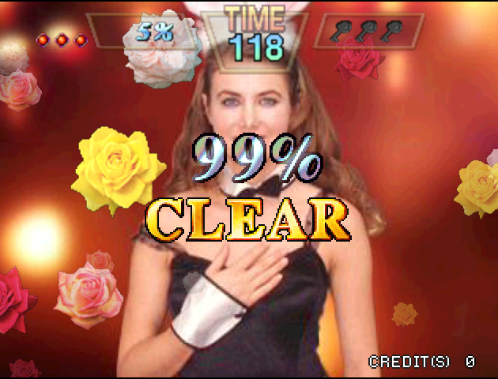
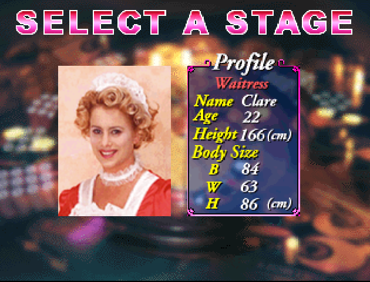
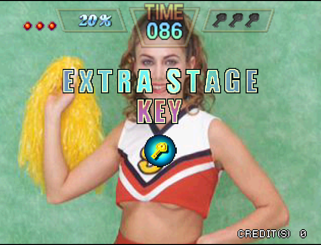

# Vivid Dolls for Sega Dreamcast

A native Sega Dreamcast port of the 1998 Visco arcade game **Vivid Dolls**, built on a
decompilation of the original Seta Aleck 64 arcade board's code.

**No game data is included.** You need your own dump of the Vivid Dolls arcade ROM. The
build puts your ROM on the disc image it makes, and the game reads everything (graphics,
photos, sound and music) from it at start-up. Please don't share any disc images that you
might build.





## AI Disclosure

This port was written with the assistance of Claude. Many hours of human testing were spent on real Dreamcast hardware, and then refining the game. If this use of AI is in conflict with your personal beliefs or values, please leave this page now. Thanks.

## Features

The arcade game's own code, decompiled to C and checked function by function against the
original, running natively on the Dreamcast: the same eight girls, photos, enemies, bosses,
items, bonus stage and ending, drawn by the Dreamcast's PowerVR graphics chip at 60 frames
a second, at 640x480, with the original music and sound effects. The photos are decoded at
run time by the game's own decoder, exactly as on the arcade board.

Version 1.0 includes:

- The whole game: the title and attract mode, girl select, all stages for all eight girls,
  the Extra Stage keys and each bonus stage.
- One or two players, with coins and credits as in the arcade.
- Full Dreamcast controller mapping.
- The original music and sound effects, mixed on the Dreamcast.
- The arcade's own operator test mode.

## Requirements

- [KallistiOS](https://github.com/KallistiOS/KallistiOS) with its SH-4 toolchain
  (`kos-cc`), set up and working, and [SH4ZAM](https://github.com/gyrovorbis/sh4zam)
  installed from kos-ports.
- [mkdcdisc](https://gitlab.com/simulant/mkdcdisc), to make the `.cdi` disc image.
- Python 3 (no extra packages needed).
- Your own Vivid Dolls ROM: the chip dump **`nus-zsaj-0.u3`** (8 MB). A byte-swapped
  `.z64` copy also works. The build checks it (SHA-1 of the `.z64`-order ROM:
  `747e9420cce23ff82b5922cd91ec43272d03fa4f`).

## Building

1. You must own the Vivid Dolls ROM. Put `nus-zsaj-0.u3` in the top folder of this
   project.
2. Load the KallistiOS environment:

   ```
   source /opt/toolchains/dc/kos/environ.sh
   ```

3. Build:

   ```
   ./build.sh
   ```

This compiles the game and makes **`vividdolls.cdi`**, with your ROM on the disc as
`VIVIDOLL.ROM` (only the 2.3 MB of it the game uses). Later builds only redo what has
changed. Nothing is downloaded.

## Running

- **Real Dreamcast:** copy `vividdolls.cdi` to your GDEMU (or burn it to a CD-R).
- **Emulator:** open `vividdolls.cdi` in [Flycast](https://github.com/flyinghead/flycast).

## Controls

| Button | In the Game |
|---|---|
| X | Insert a coin |
| Start | Start a game, or join in as player 2 |
| Analogue Stick or D-Pad | Move |
| A | Draw lines (hold); choose a girl on the select screen |
| B | Button 2 |
| Y | Button 3 |

On the select screen, left and right turn the ring of girls and A picks the one at the
front. Hold **A + B + X + Y + Start** together at any time to go back to the boot logo.

Holding **L + R + Y** on controller 1 opens the arcade's operator test mode (screen, input,
sound and output tests). Its system check wipes the arcade's settings memory, as on the real
board; use the soft reset to leave test mode.

## Saving

The arcade game doesn't save anything, so the VMU isn't used.

## Cheats

For testing, a build with a cheat can be made:

```
CHEAT=1 ./build.sh
```

This makes **`vividdolls-cheat.cdi`**. In a round, hold **L + R** (on their own) and the
photo is cleared as a 99% "perfect" clear, which also awards an Extra Stage key.

## Layout

| Folder | Contents |
|---|---|
| `src/` | The game: the decompiled arcade code (system, graphics, sound, objects, photo decoder, and the four overlays: test mode, attract, the game itself and girl select). |
| `platform/dc/` | The Dreamcast side: the libultra replacement on KallistiOS (threads, video, controllers), the display-list-to-PowerVR renderer, the sound mixer, the start-up data loader and its tables, and the Makefile. |
| `tools/` | What the build uses: checking your ROM and making the disc image. |
| `images/` | The screenshots on this page. |

## Credits

- [KallistiOS](https://github.com/KallistiOS/KallistiOS) and the Dreamcast homebrew
  community, [SH4ZAM](https://github.com/gyrovorbis/sh4zam),
  [mkdcdisc](https://gitlab.com/simulant/mkdcdisc), [Flycast](https://github.com/flyinghead/flycast).
- The decompilation was done with [splat](https://github.com/ethteck/splat),
  [spimdisasm](https://github.com/Decompollaborate/spimdisasm),
  [m2c](https://github.com/matt-kempster/m2c) and the
  [Unicorn](https://github.com/unicorn-engine/unicorn) emulator.
- Vivid Dolls is (c) 1998 Visco Corporation. This project is not affiliated with or
  endorsed by Visco or Seta.
- This is a non-commercial preservation project and is not affiliated with or endorsed by Sega.
